# Portfolio

Security researcher working on L1 nodes and multimedia attack surface. I run auditing pipelines across Go and C codebases. Focus: P2P networking, VM/sandbox safety, and memory corruption.

### Selected disclosures

Every entry is publicly verifiable: each links to a merged fix or a published advisory. Dates are the fix-merge or publication month.

| Date | Project | Severity | Vulnerability | Reference |
|------|---------|----------|---------------|-----------|
| 2026-09 | klever-go | **High** | Managed-buffer VM hooks allocate and copy attacker-sized data before bounded gas is enforced: validator memory exhaustion / OOM via `MBufferSetRandom` | [GHSA-cg9c-gcgh-qgc3](https://github.com/klever-io/klever-go/security/advisories/GHSA-cg9c-gcgh-qgc3) |
| 2026-09 | klever-go | **High** | `MBufferGetByteSlice` int32 overflow bypasses bounds check: VM panic burns all caller gas | [GHSA-vxf6-vgpv-822h](https://github.com/klever-io/klever-go/security/advisories/GHSA-vxf6-vgpv-822h) |
| 2026-09 | klever-go | **High** | `MBufferCopyByteSlice` int32 overflow bypasses bounds check: VM panic burns all caller gas | [GHSA-2m22-3m34-2qxf](https://github.com/klever-io/klever-go/security/advisories/GHSA-2m22-3m34-2qxf) |
| 2026-09 | klever-go | **High** | `MBufferSetByteSlice` int32 overflow bypasses bounds check: VM panic burns all caller gas | [GHSA-wjrx-39g9-j97q](https://github.com/klever-io/klever-go/security/advisories/GHSA-wjrx-39g9-j97q) |
| 2026-09 | klever-go | Moderate | Nil current-block-header dereference in `GetAvailableClaim` crashes node via `/address/{address}/allowance/list` | [GHSA-g797-9c85-644m](https://github.com/klever-io/klever-go/security/advisories/GHSA-g797-9c85-644m) |
| 2026-09 | klever-go | **High** | Missing read deadline in `directStreamHandler` pins one goroutine per peer stream: resource exhaustion / DoS | [GHSA-v8j2-98j2-rqv2](https://github.com/klever-io/klever-go/security/advisories/GHSA-v8j2-98j2-rqv2) |
| 2026-02 | FFmpeg | **High** | `vf_find_rect` missing bounds check in frame `compare()`: x/y min/max unclamped | [PR #21457](https://code.ffmpeg.org/FFmpeg/FFmpeg/pulls/21457) |
| 2026-02 | FFmpeg | **High** | `vf_find_rect` mishandles odd-sized images: out-of-array read | [PR #21409](https://code.ffmpeg.org/FFmpeg/FFmpeg/pulls/21409) |
| 2026-02 | FFmpeg | Medium | `scale_eval` `factor_w/h` truncation and overflow: fixed with 64-bit | [PR #21402](https://code.ffmpeg.org/FFmpeg/FFmpeg/pulls/21402) |

Additional findings remain under private disclosure or embargo and are added here as fixes ship.

### Research areas

- L1 and P2P clients (Go): resource exhaustion, pre-auth DoS, node crashes, API safety
- VM and sandbox safety: integer overflows, bounds checks, gas accounting
- Multimedia (C): memory corruption, OOB reads/writes, integer overflows

---

  

